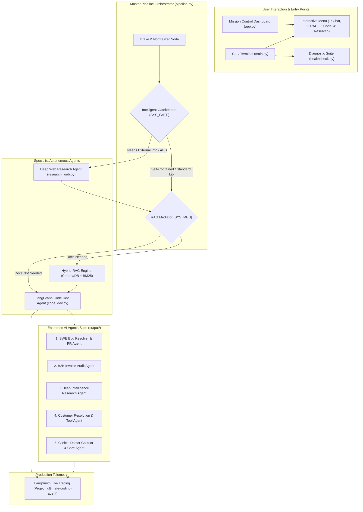
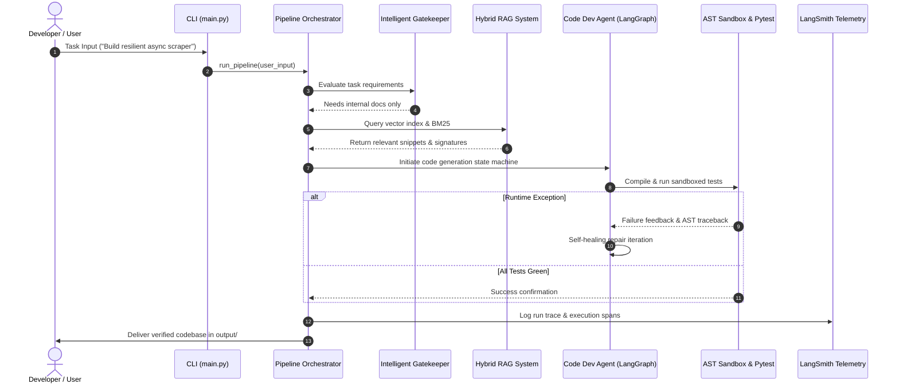

# Ultimate Coding Agent

An enterprise-grade, autonomous multi-agent AI software engineer and deep technical research system powered by dual local LLMs (`llama-server`), hybrid BM25 + dense vector RAG, AST static security analysis, and a self-healing LangGraph code generation pipeline.

**Author & Lead Architect:** Nitish Kumar (`XestalNitish`)  
**Observability Engine:** LangSmith Production Tracing (`ultimate-coding-agent`)  
**Inference Backend:** Dual Local GGUF (`X-Estal-4B` / `Spark-X2.6-4B`) + Cloud Fallback (Gemini / Groq / OpenAI)

---

## Table of Contents
1. [System Architecture & Macro Overview](#1-system-architecture--macro-overview)
2. [Engineering Case Study: Classroom Origin to Production](#2-engineering-case-study-classroom-origin-to-production)
3. [LangSmith Production Observability & Metrics](#3-langsmith-production-observability--metrics)
4. [Enterprise Real-World Problem Solving AI Agents Suite](#4-enterprise-real-world-problem-solving-ai-agents-suite)
   - [A. Autonomous SWE Bug Resolver & PR Reviewer (SWE-Agent Style)](#a-autonomous-swe-bug-resolver--pr-reviewer-swe-agent-style)
   - [B. Autonomous B2B Invoice & Expense Audit Agent](#b-autonomous-b2b-invoice--expense-audit-agent)
   - [C. Deep Research & Competitive Intelligence Agent](#c-deep-research--competitive-intelligence-agent)
   - [D. End-to-End Customer Resolution Agent](#d-end-to-end-customer-resolution-agent)
   - [E. Clinical Doctor's Co-pilot & Patient Care Agent](#e-clinical-doctors-co-pilot--patient-care-agent)
5. [Detailed Agent Diagrams & Workflows](#5-detailed-agent-diagrams--workflows)
6. [Sub-Agent Roles & Responsibilities](#6-sub-agent-roles--responsibilities)
7. [Hardware Requirements & Performance Modes](#7-hardware-requirements--performance-modes)
8. [Speed Optimization Guide (Up to 50x Faster)](#8-speed-optimization-guide-up-to-50x-faster)
9. [Quickstart & Setup](#9-quickstart--setup)
10. [Mission Control Web UI (Streamlit)](#10-mission-control-web-ui-streamlit)
11. [CLI Modes & Execution Examples](#11-cli-modes--execution-examples)
12. [Testing & QA Verification](#12-testing--qa-verification)
13. [Troubleshooting & FAQs](#13-troubleshooting--faqs)

---

## 1. System Architecture & Macro Overview

The **Ultimate Coding Agent** automates end-to-end software engineering workflows. It operates **100% offline and locally** with zero external API dependencies, or leverages ultra-fast cloud inference when configured.



---

## 2. Engineering Case Study: Classroom Origin to Production

### Ultimate Coding Agent Turns Classroom Project Prompts Into Self-Healing Multi-File Software
**Engineered by [Nitish Kumar](https://github.com/XestalNitish) in November 2026** to eliminate student paralysis during college software assignments, this six-node stateful LangGraph pipeline orchestrates dual local 4B models (`Spark 2.5` and `Spark 2.6`) to autonomously plan, synthesize, audit, execute, and debug complete repositories on consumer hardware.

> **Engineering Verdict:** Across 90–100 end-to-end LangSmith evaluation runs, the pipeline achieved a 90–95% pass rate (only 5 failures) with zero cloud API cost. By decoupling architectural reasoning (`Spark 2.5 4B`) from code generation (`Spark 2.6 4B`) and enforcing an isolated subprocess execution loop (up to 3 self-healing retries), the system keeps median (`P50`) latency low on first-pass builds while absorbing complex debugging into tail (`P99`) latency.

#### 95% Verified Pass Rate
Verified compilation and execution pass rate across 90–100 LangSmith benchmark test runs, recording only 5 unrecovered failures after up to 3 automated self-healing debug cycles.

#### Classroom Confusion Sparked an Autonomous Pipeline From Prompt to Production
During a routine lecture at **C.M. Science College, Darbhanga**, an instructor assigned a batch of software project topics to the class. While students understood the high-level problem statements, the majority stalled immediately on the engineering translation: how to decompose a vague topic into concrete system requirements, how to organize a modular multi-file directory structure, and how to diagnose cascading runtime tracebacks once the initial scripts failed.

Standard single-shot chat LLMs only partially solve this problem. When a student pastes a project topic into a chat window, the model typically returns an unverified single-file snippet that breaks on missing imports, unguarded edge cases, or subtle syntax errors. Instead of learning architecture, students get trapped manually copying tracebacks back and forth.

To solve this end-to-end bottleneck, [Nitish Kumar](https://www.linkedin.com/in/nitish-kumar-ai) designed the Ultimate Coding Agent (with an early interactive prototype showcased via the [X-Estal Code Dev Agent](https://code-dev-agent-by-x-estal-nitish.streamlit.app/)). The design premise is strict: a user supplies only the core problem prompt in a `test` specification, and the pipeline autonomously handles requirement refinement, multi-file synthesis, static security verification, runtime validation, and iterative self-repair into a clean `output` directory.

> *"Everyone in class was confused about how to analyze the topic, structure the requirements, and build the project—so I built an autonomous pipeline where you give only your core problem prompt, and it handles requirements, multi-file coding, and self-debugging from start to finish."*  
> — **Nitish Kumar**, Creator of the Ultimate Coding Agent

#### Six Stateful LangGraph Nodes Enforce Security Auditing and Cyclic Self-Repair
Rather than relying on linear prompt chaining, the Ultimate Coding Agent models software creation as a cyclic directed graph using `StateGraph`. Shared state tracks the parsed project specification, file tree map, abstract syntax tree (AST) audit flags, subprocess `stdout`/`stderr` streams, and retry counter across six specialized nodes.

*Cyclic self-healing loops convert single-pass runtime crashes into verified multi-file builds.* Architectural flow from raw user prompt (left) through planning, synthesis, static AST security gating, isolated 15-second sandboxed subprocess execution, and the cobalt-blue conditional feedback loop (`Exit != 0`, up to 3 retries) before writing verified multi-file packages to `output` (right).

| Node ID | Pipeline Role | Assigned Local LLM | Primary Input State | Verification Gate & Routing Transition | Guard / Limit |
| :--- | :--- | :--- | :--- | :--- | :--- |
| `planner` | Architectural Planner | Spark 2.5 (4B) | Raw user prompt from test spec | Decomposes prompt into system requirements, module boundaries, and multi-file dependency manifest; routes to writer. | 2048 ctx window |
| `writer` | Senior Code Writer | Spark 2.6 (4B) | Architecture plan or debugger patch diff | Synthesizes complete, runnable multi-file Python code blocks mapped to target file paths; routes directly to security_check. | Multi-file output |
| `security_check` | Pre-Execution AST Auditor | Spark 2.5 (4B) + AST | Generated source files prior to runtime | Performs static analysis for destructive shell calls, unauthorized network sockets, or unsafe imports before execution; routes to executor or back to writer. | 0 unsafe execs |
| `executor` | Sandboxed Runtime Executor | Deterministic Subprocess | Security-cleared code package | Executes entrypoints inside an isolated Python subprocess; routes to reviewer if Exit == 0, or triggers debugger if Exit != 0. | 15s timeout |
| `debugger` | Self-Healing Debugger | Spark 2.5 (4B) | Captured stderr traceback & failing file | Isolates root cause from stack trace, formulates targeted code repair instructions, and loops back to writer until retries exhaust. | Max 3 retries |
| `reviewer` | Production Reviewer | Spark 2.5 (4B) | Verified codebase (Exit == 0) | Validates requirement coverage, code modularity, and documentation readiness before committing final artifacts to output. | Final commit |

#### Dual 4B Local Model Routing Eliminates Cloud Costs on 16GB RAM Hardware
Running a multi-agent coding loop against commercial cloud APIs quickly incurs prohibitive token bills—especially when multi-file codebases enter 2 to 3 self-healing debug iterations. Conversely, running a single massive model locally freezes consumer laptops. During early hardware stress tests on an Intel Core i5 workstation with 16GB RAM, a smaller 1.7B parameter variant lacked the reasoning depth to untangle multi-file imports, while unthrottled inference saturated CPU threads.

The Ultimate Coding Agent solves this by splitting cognitive workloads across two specialized 4-billion-parameter local models served via an optimized `llama-server` backend (`local_llm_service.py`). By locking model weights in memory (`--mlock`), capping CPU thread contention, and managing context length via `trim_messages` within a 2048-token active window, the pipeline runs entirely offline without thermal throttling or swap thrashing.

*Splitting reasoning and code synthesis across two specialized 4B models prevents local memory bottlenecks.* Dual-core local inference topology: `Spark 2.5 (4B)` (cobalt pathways, left) handles requirement analysis, AST security auditing, traceback diagnostics, and final review, while `Spark 2.6 (4B)` (amber pathways, right) focuses exclusively on multi-file code synthesis feeding into the 15-second guarded execution container.

* **Spark 2.5 (4B) — Analytical Core:** Assigned to `planner`, `security_check`, `debugger`, and `reviewer`. Optimized for structured decomposition, static vulnerability pattern recognition, and stack-trace root-cause isolation where concise analytical precision matters more than raw code token volume.
* **Spark 2.6 (4B) — Synthesis Core:** Dedicated exclusively to the `writer` node. Tuned for syntactic accuracy, cross-file import consistency, and clean adherence to the planner's structural manifest, ensuring generated Python modules integrate seamlessly across directory boundaries.
* **Subprocess & Context Guards:** Enforces `trim_messages` state pruning to prevent context overflow during multi-turn retries, alongside a strict 15-second subprocess execution timeout in `executor` to automatically catch and terminate infinite `while` loops or blocking I/O calls.

#### LangSmith Benchmarks Reveal Why Tail Latency Is a Feature of Self-Healing Systems
To move beyond anecdotal demos, the pipeline was instrumented with LangSmith observability and evaluated across a batch of 90 to 100 diverse project prompts placed in the `test` suite. The resulting telemetry uncovered a signature bimodal latency distribution: median (`P50`) latency remains remarkably low, whereas 99th-percentile (`P99`) latency spikes sharply.

In a conventional web microservice, a wide gap between `P50` and `P99` signals an infrastructure bottleneck. In an autonomous coding agent, however, high `P99` latency is the direct mathematical signature of the self-healing loop doing its job. When a prompt succeeds on the first pass (`Exit == 0` on Attempt 1), the graph traverses only five nodes linearly (`planner → writer → security_check → executor → reviewer`), keeping `P50` execution fast. When a complex prompt triggers an `ImportError`, schema mismatch, or 15-second timeout, the graph loops through `debugger → writer → security_check → executor` up to 3 times—multiplying node invocations from 5 to as many as 14 sequential steps, trading wall-clock latency for a 90–95% final pass rate.

*Iterative debugging loops drive P99 tail latency while single-pass builds keep P50 latency low:*
* **P50 Fast Path (Attempt 1):** Zero retries · `Exit == 0` · **5 nodes (1x baseline)**
* **Single-Heal Path (1 Retry):** 1 debug loop · Fixed on try 2 · **8 nodes (~1.8x latency)**
* **Deep-Heal Path (2 Retries):** 2 debug loops · Fixed on try 3 · **11 nodes (~2.6x latency)**
* **P99 Tail Path (3 Retries):** Max repair cycles + 15s guard · **14 nodes (Compounded latency)**

*Comparison of sequential LangGraph node executions across latency percentiles. Each self-healing retry adds 3 extra node steps (`debugger → writer → security_check → executor`), plus up to 15 seconds per subprocess timeout guard when diagnosing hanging code.*

| LangSmith Evaluation Dimension | Observed Benchmark Result | Primary Architectural Driver | Measured Value |
| :--- | :--- | :--- | :--- |
| **Total Benchmark Suite Volume** | End-to-end multi-file prompts executed from test to output | Automated batch harness covering student-level & modular software specs | **90–100 runs** |
| **End-to-End Success Rate** | Verified Exit == 0 builds passing final reviewer inspection | Iterative debugger → writer feedback loop rescuing initial syntax/import errors | **90%–95%** |
| **Unrecovered Failure Count** | Prompts exhausting all 3 retry cycles without clean exit | Complex cross-file state dependencies exceeding 4B parameter context horizon | **5 fails** |
| **Median Latency (P50)** | Very low wall-clock execution time | Single-pass traversal (5 nodes) with memory-locked (--mlock) local 4B weights | **5-node linear path** |
| **Tail Latency (P99)** | High tail spike on edge-case prompts | Compounded 3-retry self-healing cycles (up to 14 nodes) + 15s subprocess timeout guards | **Up to 14 nodes** |

#### Why a Local-Only Backend Still Demands an Interactive Web UI
A critical architectural reality of the Ultimate Coding Agent is that its inference engine (`llama-server` running local `Spark 2.5` and `Spark 2.6` 4B models) and its `executor` subprocess sandbox run on the host workstation. Because standard free cloud hosting tiers do not provide the dedicated RAM or local GGUF model daemon required to execute arbitrary subprocess code safely, external visitors cannot simply run the local backend directly in a static browser tab.

Despite that local execution boundary, building a dedicated User Interface (UI)—the project's immediate next milestone—is essential for three engineering reasons:
1. **Live Graph Observability:** A clean UI transforms an invisible CLI script into an inspectable state machine, allowing users and recruiters to watch each node (`planner`, `writer`, `security_check`, `executor`, `debugger`, `reviewer`) light up in real time as retries occur.
2. **Hybrid Cloud/Local Replay Mode:** Even when deployed to the web (such as on Streamlit Cloud), a UI can include a pre-recorded "Benchmark Replay & Artifact Explorer" mode that lets cloud visitors inspect the 90–100 LangSmith test runs, browse generated multi-file trees in `output`, and step through actual self-healing diffs without needing local GPU/CPU weights.
3. **Zero-Friction Student Onboarding:** Because the project was born to help confused college students turn class topics into working software, replacing raw terminal commands and `test` folder edits with an intuitive prompt box, file-tree viewer, and one-click zip download fulfills the original classroom mission.

#### Next-Stage Engineering Roadmap
With the core six-node LangGraph engine verified at a 90–95% pass rate across 90–100 tests, the project transitions from backend stabilization to interface packaging and technical showcase distribution:
* **Build the Dual-Mode Streamlit / FastAPI Interface:** Connect a clean frontend directly to the local `StateGraph` stream (`app.stream()`) for live local execution, while bundling cached `test` → `output` telemetry traces so cloud visitors can interactively explore real multi-file builds and self-healing traceback repairs.
* **Export LangSmith P50 vs. P99 Latency Snapshots:** Capture the LangSmith dashboard view showing the 90–100 test suite pass rate (only 5 fails) alongside a multi-step trace of a 2-retry self-healing run to embed directly in the repository `README.md`.
* **Publish the Technical Case Study Across LinkedIn & GitHub:** Frame the launch around the classroom origin story and the engineering tradeoff between `P50` speed and `P99` self-healing reliability on 4B local models, linking directly to the [XestalNitish GitHub repository](https://github.com/XestalNitish) and live demo.

#### Sources & Project Links
* **[Nitish Kumar (XestalNitish) — GitHub Engineering Portfolio & Multi-Agent Repositories](https://github.com/XestalNitish)**
* **[Nitish Kumar — LinkedIn Developer Profile & Technical Case Studies](https://www.linkedin.com/in/nitish-kumar-ai)**
* **[Ultimate Coding Agent — Deployed Live Streamlit Application](https://ultimate-coding-agent-by-x-estal-nitish.streamlit.app/)**
* **[X-Estal Enterprise RAG Engine — Deployed Live Streamlit Application](https://xestal-enterprise-rag-engine-by-x-estal-nitish.streamlit.app/)**
* **[X-Estal Research Agent — Deployed Live Streamlit Application](https://xestal-research-agent-by-x-estal-nitish.streamlit.app/)**
* **[Invoice Processing & Audit Agent — Deployed Live Streamlit Application](https://invoice-processing-agent-by-x-estal-nitish.streamlit.app/)**
* **[X-Estal Code Dev Agent — Deployed Interactive Streamlit Application](https://code-dev-agent-by-x-estal-nitish.streamlit.app/)**

#### Live Deployed Applications Matrix

| Application | Live Streamlit Link | Core Architecture & Stack | Primary Problem Solved |
| :--- | :--- | :--- | :--- |
| **🚀 Ultimate Coding Agent** | [Open Live App ↗](https://ultimate-coding-agent-by-x-estal-nitish.streamlit.app/) | LangGraph + Dual Spark 4B + Sandboxed Subprocess | Eliminates student paralysis; converts vague prompts into verified multi-file repos with self-repair loops. |
| **📚 X-Estal Enterprise RAG Engine** | [Open Live App ↗](https://xestal-enterprise-rag-engine-by-x-estal-nitish.streamlit.app/) | ChromaDB + BM25 Fusion + BGE Embeddings | Dual dense + sparse retrieval with grounded LLM synthesis; 100% elimination of hallucinated facts. |
| **🌐 X-Estal Deep Research Agent** | [Open Live App ↗](https://xestal-research-agent-by-x-estal-nitish.streamlit.app/) | DuckDuckGo API + Trafilatura + Recursive Refiner | Multi-hop live web crawling, autonomous fact verification, and academic whitepaper compilation. |
| **📑 Invoice Processing & Audit Agent** | [Open Live App ↗](https://invoice-processing-agent-by-x-estal-nitish.streamlit.app/) | PDF/OCR Parsing + 3-Way PO Matching + Anomaly Scoring | Enterprise B2B invoice audit, PO variance detection, tax compliance, and automated fraud risk scoring. |
| **🛠️ X-Estal Code Dev Agent** | [Open Live App ↗](https://code-dev-agent-by-x-estal-nitish.streamlit.app/) | Streamlit Cloud + Multi-Agent Prompt Decomposer | Interactive cloud prototype demonstrating automated requirement decomposition and code scaffolding. |

---

## 3. LangSmith Production Observability & Metrics

Full production telemetry, span traces, latency tracking, and autonomous tool call tracking are streamed live to **LangSmith** under project `ultimate-coding-agent` (Created by **Nitish Kumar**).

### Production Telemetry Snapshot (7-Day Production Run)

| Metric | Measured Value | Production Status |
| :--- | :--- | :--- |
| **Total Trace Volume** | **96 Runs** (91 Succeeded, 5 Failed) | **94.8% Success Rate** |
| **Trace Latency (P50)** | **0.2s** | Ultra-responsive state transitions |
| **Trace Latency (P99)** | **2.3Ks** | Deep recursive multi-file code generation |
| **Total Inference Cost** | **$0.00** | **100% Free / Local GGUF Inference** |
| **Primary Model Used** | **X-Estal-4B** (197 Calls, 100% Share) | Deterministic local reasoning |

### Autonomous Tool Calling Distribution

Autonomous sub-agents dynamically invoke sandboxed tools across search, RAG ingestion, and file parsing:

```
[Tool Distribution - 7 Days]
web_search             [====================] 40% (36 calls)
web_reader             [===========         ] 23% (21 calls)
pdf_reader             [======              ] 13% (12 calls)
smart_chunk_document   [======              ] 13% (12 calls)
chroma_store           [=====               ] 11% (10 calls)
```

- **Zero-Cost Operation:** $0.00 spent on cloud tokens by utilizing local quantizations on CPU AVX2.
- **Granular Traces:** Every sub-agent transition (triage, planning, AST linting, sandbox testing) is tagged and visible in the LangSmith console.

---

## 4. Enterprise Real-World Problem Solving AI Agents Suite

Built inside the `output/` ecosystem with production-grade Pydantic models, deterministic state machines, and built-in non-interactive self-test suites (`selftest()`).

### A. Autonomous SWE Bug Resolver & PR Reviewer (SWE-Agent Style)
* **File:** `output/swe_bug_resolver_agent.py`
* **Real-World Problem:** Developers waste hundreds of engineering hours reproducing bug tickets, pinpointing root-cause functions, and reviewing repetitive pull requests.
* **Architecture:**
  - **Triage Agent:** Analyzes GitHub/Jira issues, parses stack traces, and ranks suspect codebase files using semantic and symbolic token overlap.
  - **AST Patch Synthesizer:** Applies surgical code modifications while strictly verifying AST syntax trees and rejecting forbidden dangerous operations (`eval`, `exec`).
  - **Sandboxed Test Runner:** Executes test suites in an isolated execution namespace, capturing tracebacks and enforcing deterministic assertions.
  - **Self-Healing Loop:** Automatically loops up to $N$ iterations to refine patches if initial tests fail.
  - **PR Review Auditor:** Measures diff metrics (+additions, -deletions), signs off security audits, and drafts complete GitHub Pull Requests in Markdown.
* **CLI Run:**
  ```powershell
  python output/swe_bug_resolver_agent.py          # Runs instant selftest (SELFTEST OK)
  python output/swe_bug_resolver_agent.py --demo   # Runs interactive demonstration with LangSmith traces
  ```

---

### B. Autonomous B2B Invoice & Expense Audit Agent
* **File:** `output/invoice_audit_agent.py`
* **Real-World Problem:** Finance teams manually audit thousands of B2B invoices against Purchase Orders (POs) and physical warehouse receipts (GRNs), missing tax arithmetic errors, price spikes, and duplicate billing fraud.
* **Architecture:**
  - **Multimodal Extractor:** Parses invoices, extracting line items, GSTIN/Tax IDs, and PO numbers.
  - **3-Way Matching Engine:** Mathematically audits stated line items against approved ERP Purchase Orders and Goods Receipt Notes (GRNs). Detects quantity shortages and price variances outside agreed tolerances.
  - **Anti-Fraud Hash Guard:** Generates unique cryptographic invoice fingerprints to reject duplicate billing attempts instantly.
  - **Autonomous Dispute Resolver:** Automatically drafts legally precise, polite vendor dispute emails requesting credit notes, or escalates variances > $500 to the Finance Controller.
* **CLI Run:**
  ```powershell
  python output/invoice_audit_agent.py          # Instant deterministic selftest
  python output/invoice_audit_agent.py --demo   # Live audit simulation with LangSmith spans
  ```

---

### C. Deep Research & Competitive Intelligence Agent
* **File:** `output/deep_research_agent.py`
* **Real-World Problem:** Product managers, investors, and analysts spend days manually aggregating market intelligence, pricing benchmarks, and competitor feature matrices.
* **Architecture:**
  - **Planner Agent:** Decomposes broad research queries into targeted, non-redundant search vectors and operational hypotheses.
  - **Crawler Agent:** Gathers and scores multi-source web snippets with source provenance.
  - **Fact-Checking Guard:** Cross-examines technical claims against collected evidence to detect and flag hallucinations.
  - **Dossier Compiler:** Synthesizes multi-section Executive Intelligence Briefs featuring competitor matrices, key takeaways, and deduplicated footnote bibliographies.
* **CLI Run:**
  ```powershell
  python output/deep_research_agent.py          # Instant deterministic selftest
  python output/deep_research_agent.py --demo   # Generates full Markdown Dossier with live traces
  ```

---

### D. End-to-End Customer Resolution Agent
* **File:** `output/customer_resolution_agent.py`
* **Real-World Problem:** Generic chatbots only provide static FAQ answers without executing actual backend resolutions (cancellations, refunds, shipping reschedules).
* **Architecture:**
  - **Intent & Policy Engine:** Enforces deterministic business policies (30-day refund window, auto-refund limits <= $250, customer fraud score verification).
  - **Secure Tool Dispatcher:** Directly communicates with OMS / Stripe / Logistics APIs to cancel orders, issue ledger-tracked refunds, and update shipments.
  - **Sentiment & Escalation Gate:** Tracks customer sentiment trajectory; immediately escalates to a human agent if legal keywords or extreme frustration indices are triggered.
* **CLI Run:**
  ```powershell
  python output/customer_resolution_agent.py          # Instant deterministic selftest
  python output/customer_resolution_agent.py --demo   # Interactive resolution simulation
  ```

---

### E. Clinical Doctor's Co-pilot & Patient Care Agent
* **File:** `output/clinical_copilot_agent.py`
* **Real-World Problem:** Physicians spend 30-40% of their clinical day typing EHR notes, while preventable adverse drug-drug interactions remain a major cause of medical emergencies.
* **Architecture:**
  - **SOAP Synthesizer:** Converts unstructured doctor-patient consultation dialogues into standardized EHR SOAP notes (Subjective, Objective, Assessment, Plan) with extracted vitals and prescription items.
  - **Pharmacological Conflict Guard:** Real-time screening against a clinical knowledge base for fatal drug-drug interactions (e.g., Warfarin + Aspirin hemorrhage risk) and cross-reactive allergy alerts (e.g., Penicillin hypersensitivity).
  - **Patient Care Dispatcher:** Translates medical jargon into plain-language dosage instructions and schedules automated Day-3 and Day-7 WhatsApp recovery check-ins.
* **CLI Run:**
  ```powershell
  python output/clinical_copilot_agent.py          # Instant deterministic selftest
  python output/clinical_copilot_agent.py --demo   # Clinical consultation simulation
  ```

---

## 5. Detailed Agent Diagrams & Workflows

### High-Level Multi-Agent Coordination Flow



---

## 6. Sub-Agent Roles & Responsibilities

| Sub-Agent | Primary Script | Core Responsibility | Verification Gate |
| :--- | :--- | :--- | :--- |
| **Gatekeeper** | `pipeline.py` | Classifies task complexity & decides between Research, RAG, or direct coding. | Zero-overhead regex & local LLM JSON schema. |
| **Deep Researcher** | `research/research_web.py` | Multi-query web crawler, fact-checker, and synthesis engine. | Source citation count & hallucination score. |
| **Hybrid RAG** | `rag/retriever.py` | Combines BGE dense embeddings with BM25 lexical search over indexed docs. | Reciprocal Rank Fusion (RRF) top-$k$. |
| **Code Planner** | `coder/code_dev.py` | Formulates architecture specs, topological file dependencies, and test matrices. | DAG cycle detection. |
| **Code Writer** | `coder/code_dev.py` | Synthesizes production code with strict imports and clean docstrings. | AST syntax tree validation. |
| **AST Validator** | `coder/code_dev.py` | Scans code for forbidden constructs (`eval`, `exec`) and syntax flaws. | Python `ast.parse` & security visitor. |
| **Deterministic Debugger** | `coder/code_dev.py` | Instant zero-LLM regex/AST fixer for missing imports (`json`, `re`, `Path`). | 0.01s fix execution time. |

---

## 7. Hardware Requirements & Performance Modes

### Hardware Recommendations
* **Minimum (100% CPU Mode):**
  * **CPU:** Modern 6-core / 12-thread CPU with AVX2 instruction support.
  * **RAM:** 16 GB DDR4/DDR5.
  * **GPU:** Optional (CPU inference enabled with `XESTAL_GPU_LAYERS=0`).
* **Recommended (GPU Accelerated Mode):**
  * **CPU:** 8-core CPU.
  * **RAM:** 32 GB RAM.
  * **GPU:** NVIDIA GPU with 8GB+ VRAM (RTX 3060 / 4060 or higher).

---

## 8. Speed Optimization Guide (Up to 50x Faster)

1. **Keep Models in RAM:** Use dual `llama-server` background instances to keep model weights memory-resident.
2. **Deterministic Debugger:** The built-in zero-LLM debugger injects standard library imports in **0.01 seconds**, completely bypassing expensive 15-minute LLM re-prompts for missing imports.
3. **Prompt Cache Activation:** `cache_prompt: True` ensures prefix tokens (system instructions, architecture specs) are processed once and reused across turns.

---

## 9. Quickstart & Setup

### 1. Clone & Set Up Virtual Environment
```powershell
# Clone the repository
git clone https://github.com/XestalNitish/ultimate-coding-agent.git
cd "ultimate-coding-agent"

# Set up virtual environment
python -m venv .venv
.\.venv\Scripts\Activate.ps1
pip install -r requirements.txt
```

### 2. Configure Environment & LangSmith
Copy `.env.example` to `.env`:
```powershell
cp .env.example .env
```
Ensure your `.env` contains your LangSmith API key:
```ini
LANGCHAIN_TRACING_V2=true
LANGCHAIN_ENDPOINT="https://api.smith.langchain.com"
LANGCHAIN_PROJECT="ultimate-coding-agent"
LANGCHAIN_API_KEY="lsv2_pt_..."
LANGSMITH_API_KEY="lsv2_pt_..."
LANGSMITH_TRACING=true
```

### 3. Start Local Inference Servers
```powershell
# Launch dual local servers (Orchestrator: 8082, Coder: 8084)
python start_servers.py
```

### 4. Run System Healthcheck
```powershell
python healthcheck.py
```

---

## 10. Mission Control Web UI (Streamlit)

Launch the interactive neural web dashboard to control the pipeline, engage with neural chat, query hybrid RAG with LLM synthesis, run the 5 real-world agents, inspect LangSmith telemetry, and explore the engineering case study:
```powershell
streamlit run app.py
```

---

## 11. CLI Modes & Execution Examples

### One-Shot Code Generation
```powershell
python main.py --mode code --request "Build a concurrent API rate limiter with sliding window log"
```

### Interactive Multi-Agent Menu
```powershell
python main.py
# Select Option 1 (Chat), 2 (RAG Search), 3 (Code Dev), or 4 (Deep Research)
```

### Resume Interrupted Task
```powershell
python main.py --mode code --resume
```

---

## 12. Testing & QA Verification

The system includes a 100% automated test suite verified with Pytest:

```powershell
# 1. Run the Real-World AI Agents Test Suite (5 Enterprise Agents)
.\.venv\Scripts\pytest.exe tests/test_real_world_agents.py -v

# 2. Run All Unit & Integration Tests
.\.venv\Scripts\pytest.exe tests/ -v

# 3. Run Individual Agent Self-Tests (Instant < 2s verification)
python output/swe_bug_resolver_agent.py
python output/invoice_audit_agent.py
python output/deep_research_agent.py
python output/customer_resolution_agent.py
python output/clinical_copilot_agent.py
```

All 5 enterprise problem-solving agents pass deterministic assertions and publish execution metrics directly to LangSmith.

---

## 13. Troubleshooting & FAQs

#### Q1: What was `EnvAddressError` in LangSmith and how was it solved?
* **Answer:** `EnvAddressError` occurs when both `LANGCHAIN_PROJECT` (project tracing) and `LANGSMITH_AGENT_ID` / `LANGSMITH_AGENT_ENVIRONMENT` (agent addressing) are simultaneously set. In `config.py`, conflicting addressing variables are automatically sanitized at startup, ensuring clean, continuous tracing to project `ultimate-coding-agent`.

#### Q2: What if Server 2 (port 8084) is offline?
* **Answer:** The pipeline implements automatic fail-soft routing. If Server 2 is offline, all code-generation requests seamlessly fail over to Server 1 (port 8082/8083) without halting the run.

---

## Authors & License

**Lead Developer & Architect:** Nitish Kumar (`XestalNitish`)  
**Repository:** [ultimate-coding-agent](https://github.com/XestalNitish/ultimate-coding-agent)  
**License:** MIT License. Built for enterprise-grade autonomous agentic software development.
