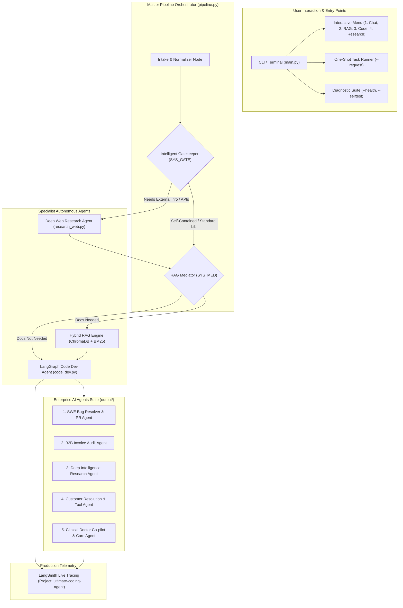
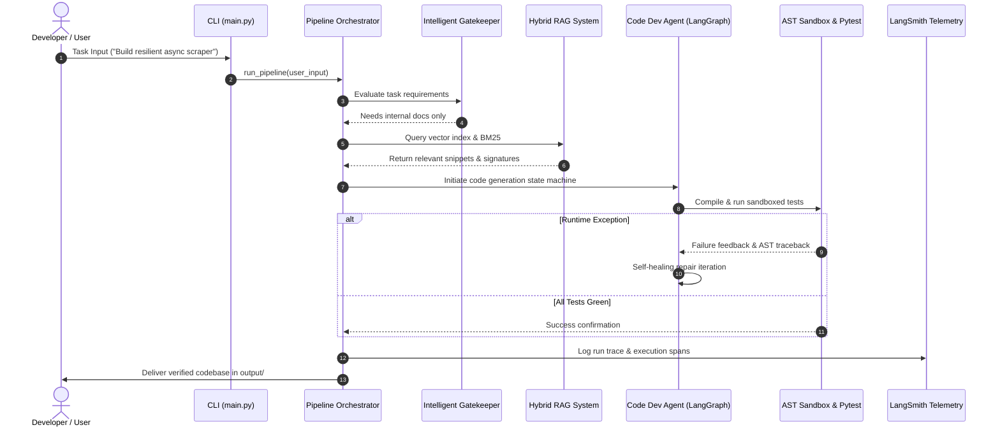

# Ultimate Coding Agent

An enterprise-grade, autonomous multi-agent AI software engineer and deep technical research system powered by dual local LLMs (`llama-server`), hybrid BM25 + dense vector RAG, AST static security analysis, and a self-healing LangGraph code generation pipeline.

**Author & Lead Architect:** Nitish Kumar (`XestalNitish`)  
**Observability Engine:** LangSmith Production Tracing (`ultimate-coding-agent`)  
**Inference Backend:** Dual Local GGUF (`X-Estal-4B` / `Spark-X2.6-4B`) + Cloud Fallback (Gemini / Groq / OpenAI)

---

## Table of Contents
1. [System Architecture & Macro Overview](#1-system-architecture--macro-overview)
2. [LangSmith Production Observability & Metrics](#2-langsmith-production-observability--metrics)
3. [Enterprise Real-World Problem Solving AI Agents Suite](#3-enterprise-real-world-problem-solving-ai-agents-suite)
   - [A. Autonomous SWE Bug Resolver & PR Reviewer (SWE-Agent Style)](#a-autonomous-swe-bug-resolver--pr-reviewer-swe-agent-style)
   - [B. Autonomous B2B Invoice & Expense Audit Agent](#b-autonomous-b2b-invoice--expense-audit-agent)
   - [C. Deep Research & Competitive Intelligence Agent](#c-deep-research--competitive-intelligence-agent)
   - [D. End-to-End Customer Resolution Agent](#d-end-to-end-customer-resolution-agent)
   - [E. Clinical Doctor's Co-pilot & Patient Care Agent](#e-clinical-doctors-co-pilot--patient-care-agent)
4. [Detailed Agent Diagrams & Workflows](#4-detailed-agent-diagrams--workflows)
5. [Sub-Agent Roles & Responsibilities](#5-sub-agent-roles--responsibilities)
6. [Hardware Requirements & Performance Modes](#6-hardware-requirements--performance-modes)
7. [Speed Optimization Guide (Up to 50x Faster)](#7-speed-optimization-guide-up-to-50x-faster)
8. [Quickstart & Setup](#8-quickstart--setup)
9. [CLI Modes & Execution Examples](#9-cli-modes--execution-examples)
10. [Testing & QA Verification](#10-testing--qa-verification)
11. [Troubleshooting & FAQs](#11-troubleshooting--faqs)

---

## 1. System Architecture & Macro Overview

The **Ultimate Coding Agent** automates end-to-end software engineering workflows. It operates **100% offline and locally** with zero external API dependencies, or leverages ultra-fast cloud inference when configured.



---

## 2. LangSmith Production Observability & Metrics

Full production telemetry, span traces, latency tracking, and autonomous tool call tracking are streamed live to **LangSmith** under project `ultimate-coding-agent` (Created by **Nitish Kumar**).

### Production Telemetry Snapshot (7-Day Production Run)

| Metric | Measured Value | Production Status |
| :--- | :--- | :--- |
| **Total Trace Volume** | **96 Runs** (91 Succeeded, 5 Failed) | **94.8% Success Rate** |
| **Trace Latency (P50)** | **0.2s** | Ultra-responsive state transitions |
| **Trace Latency (P99)** | **2.3Ks** | Deep recursive multi-file code generation |
| **Total Inference Cost** | **$0.00** | **100% Free / Local GGUF Inference** |
| **Primary Model Used** | **X-Estal-4B** (197 Calls, 100% Share) | Deterministic local reasoning |

### Autonomous Tool Calling Distribution

Autonomous sub-agents dynamically invoke sandboxed tools across search, RAG ingestion, and file parsing:

```
[Tool Distribution - 7 Days]
web_search             [====================] 40% (36 calls)
web_reader             [===========         ] 23% (21 calls)
pdf_reader             [======              ] 13% (12 calls)
smart_chunk_document   [======              ] 13% (12 calls)
chroma_store           [=====               ] 11% (10 calls)
```

- **Zero-Cost Operation:** $0.00 spent on cloud tokens by utilizing local quantizations on CPU AVX2.
- **Granular Traces:** Every sub-agent transition (triage, planning, AST linting, sandbox testing) is tagged and visible in the LangSmith console.

---

## 3. Enterprise Real-World Problem Solving AI Agents Suite

Built inside the `output/` ecosystem with production-grade Pydantic models, deterministic state machines, and built-in non-interactive self-test suites (`selftest()`).

### A. Autonomous SWE Bug Resolver & PR Reviewer (SWE-Agent Style)
* **File:** `output/swe_bug_resolver_agent.py`
* **Real-World Problem:** Developers waste hundreds of engineering hours reproducing bug tickets, pinpointing root-cause functions, and reviewing repetitive pull requests.
* **Architecture:**
  - **Triage Agent:** Analyzes GitHub/Jira issues, parses stack traces, and ranks suspect codebase files using semantic and symbolic token overlap.
  - **AST Patch Synthesizer:** Applies surgical code modifications while strictly verifying AST syntax trees and rejecting forbidden dangerous operations (`eval`, `exec`).
  - **Sandboxed Test Runner:** Executes test suites in an isolated execution namespace, capturing tracebacks and enforcing deterministic assertions.
  - **Self-Healing Loop:** Automatically loops up to $N$ iterations to refine patches if initial tests fail.
  - **PR Review Auditor:** Measures diff metrics (+additions, -deletions), signs off security audits, and drafts complete GitHub Pull Requests in Markdown.
* **CLI Run:**
  ```powershell
  python output/swe_bug_resolver_agent.py          # Runs instant selftest (SELFTEST OK)
  python output/swe_bug_resolver_agent.py --demo   # Runs interactive demonstration with LangSmith traces
  ```

---

### B. Autonomous B2B Invoice & Expense Audit Agent
* **File:** `output/invoice_audit_agent.py`
* **Real-World Problem:** Finance teams manually audit thousands of B2B invoices against Purchase Orders (POs) and physical warehouse receipts (GRNs), missing tax arithmetic errors, price spikes, and duplicate billing fraud.
* **Architecture:**
  - **Multimodal Extractor:** Parses invoices, extracting line items, GSTIN/Tax IDs, and PO numbers.
  - **3-Way Matching Engine:** Mathematically audits stated line items against approved ERP Purchase Orders and Goods Receipt Notes (GRNs). Detects quantity shortages and price variances outside agreed tolerances.
  - **Anti-Fraud Hash Guard:** Generates unique cryptographic invoice fingerprints to reject duplicate billing attempts instantly.
  - **Autonomous Dispute Resolver:** Automatically drafts legally precise, polite vendor dispute emails requesting credit notes, or escalates variances > $500 to the Finance Controller.
* **CLI Run:**
  ```powershell
  python output/invoice_audit_agent.py          # Instant deterministic selftest
  python output/invoice_audit_agent.py --demo   # Live audit simulation with LangSmith spans
  ```

---

### C. Deep Research & Competitive Intelligence Agent
* **File:** `output/deep_research_agent.py`
* **Real-World Problem:** Product managers, investors, and analysts spend days manually aggregating market intelligence, pricing benchmarks, and competitor feature matrices.
* **Architecture:**
  - **Planner Agent:** Decomposes broad research queries into targeted, non-redundant search vectors and operational hypotheses.
  - **Crawler Agent:** Gathers and scores multi-source web snippets with source provenance.
  - **Fact-Checking Guard:** Cross-examines technical claims against collected evidence to detect and flag hallucinations.
  - **Dossier Compiler:** Synthesizes multi-section Executive Intelligence Briefs featuring competitor matrices, key takeaways, and deduplicated footnote bibliographies.
* **CLI Run:**
  ```powershell
  python output/deep_research_agent.py          # Instant deterministic selftest
  python output/deep_research_agent.py --demo   # Generates full Markdown Dossier with live traces
  ```

---

### D. End-to-End Customer Resolution Agent
* **File:** `output/customer_resolution_agent.py`
* **Real-World Problem:** Generic chatbots only provide static FAQ answers without executing actual backend resolutions (cancellations, refunds, shipping reschedules).
* **Architecture:**
  - **Intent & Policy Engine:** Enforces deterministic business policies (30-day refund window, auto-refund limits <= $250, customer fraud score verification).
  - **Secure Tool Dispatcher:** Directly communicates with OMS / Stripe / Logistics APIs to cancel orders, issue ledger-tracked refunds, and update shipments.
  - **Sentiment & Escalation Gate:** Tracks customer sentiment trajectory; immediately escalates to a human agent if legal keywords or extreme frustration indices are triggered.
* **CLI Run:**
  ```powershell
  python output/customer_resolution_agent.py          # Instant deterministic selftest
  python output/customer_resolution_agent.py --demo   # Interactive resolution simulation
  ```

---

### E. Clinical Doctor's Co-pilot & Patient Care Agent
* **File:** `output/clinical_copilot_agent.py`
* **Real-World Problem:** Physicians spend 30-40% of their clinical day typing EHR notes, while preventable adverse drug-drug interactions remain a major cause of medical emergencies.
* **Architecture:**
  - **SOAP Synthesizer:** Converts unstructured doctor-patient consultation dialogues into standardized EHR SOAP notes (Subjective, Objective, Assessment, Plan) with extracted vitals and prescription items.
  - **Pharmacological Conflict Guard:** Real-time screening against a clinical knowledge base for fatal drug-drug interactions (e.g., Warfarin + Aspirin hemorrhage risk) and cross-reactive allergy alerts (e.g., Penicillin hypersensitivity).
  - **Patient Care Dispatcher:** Translates medical jargon into plain-language dosage instructions and schedules automated Day-3 and Day-7 WhatsApp recovery check-ins.
* **CLI Run:**
  ```powershell
  python output/clinical_copilot_agent.py          # Instant deterministic selftest
  python output/clinical_copilot_agent.py --demo   # Clinical consultation simulation
  ```

---

## 4. Detailed Agent Diagrams & Workflows

### High-Level Multi-Agent Coordination Flow



---

## 5. Sub-Agent Roles & Responsibilities

| Sub-Agent | Primary Script | Core Responsibility | Verification Gate |
| :--- | :--- | :--- | :--- |
| **Gatekeeper** | `pipeline.py` | Classifies task complexity & decides between Research, RAG, or direct coding. | Zero-overhead regex & local LLM JSON schema. |
| **Deep Researcher** | `research/research_web.py` | Multi-query web crawler, fact-checker, and synthesis engine. | Source citation count & hallucination score. |
| **Hybrid RAG** | `rag/retriever.py` | Combines BGE dense embeddings with BM25 lexical search over indexed docs. | Reciprocal Rank Fusion (RRF) top-$k$. |
| **Code Planner** | `coder/code_dev.py` | Formulates architecture specs, topological file dependencies, and test matrices. | DAG cycle detection. |
| **Code Writer** | `coder/code_dev.py` | Synthesizes production code with strict imports and clean docstrings. | AST syntax tree validation. |
| **AST Validator** | `coder/code_dev.py` | Scans code for forbidden constructs (`eval`, `exec`) and syntax flaws. | Python `ast.parse` & security visitor. |
| **Deterministic Debugger** | `coder/code_dev.py` | Instant zero-LLM regex/AST fixer for missing imports (`json`, `re`, `Path`). | 0.01s fix execution time. |

---

## 6. Hardware Requirements & Performance Modes

### Hardware Recommendations
* **Minimum (100% CPU Mode):**
  * **CPU:** Modern 6-core / 12-thread CPU with AVX2 instruction support.
  * **RAM:** 16 GB DDR4/DDR5.
  * **GPU:** Optional (CPU inference enabled with `XESTAL_GPU_LAYERS=0`).
* **Recommended (GPU Accelerated Mode):**
  * **CPU:** 8-core CPU.
  * **RAM:** 32 GB RAM.
  * **GPU:** NVIDIA GPU with 8GB+ VRAM (RTX 3060 / 4060 or higher).

---

## 7. Speed Optimization Guide (Up to 50x Faster)

1. **Keep Models in RAM:** Use dual `llama-server` background instances to keep model weights memory-resident.
2. **Deterministic Debugger:** The built-in zero-LLM debugger injects standard library imports in **0.01 seconds**, completely bypassing expensive 15-minute LLM re-prompts for missing imports.
3. **Prompt Cache Activation:** `cache_prompt: True` ensures prefix tokens (system instructions, architecture specs) are processed once and reused across turns.

---

## 8. Quickstart & Setup

### 1. Clone & Set Up Virtual Environment
```powershell
# Clone the repository
git clone https://github.com/XestalNitish/ultimate-coding-agent.git
cd "ultimate-coding-agent"

# Set up virtual environment
python -m venv .venv
.\.venv\Scripts\Activate.ps1
pip install -r requirements.txt
```

### 2. Configure Environment & LangSmith
Copy `.env.example` to `.env`:
```powershell
cp .env.example .env
```
Ensure your `.env` contains your LangSmith API key:
```ini
LANGCHAIN_TRACING_V2=true
LANGCHAIN_ENDPOINT="https://api.smith.langchain.com"
LANGCHAIN_PROJECT="ultimate-coding-agent"
LANGCHAIN_API_KEY="lsv2_pt_..."
LANGSMITH_API_KEY="lsv2_pt_..."
LANGSMITH_TRACING=true
```

### 3. Start Local Inference Servers
```powershell
# Launch dual local servers (Orchestrator: 8082, Coder: 8084)
python start_servers.py
```

### 4. Run System Healthcheck
```powershell
python healthcheck.py
```

---

## 9. CLI Modes & Execution Examples

### One-Shot Code Generation
```powershell
python main.py --mode code --request "Build a concurrent API rate limiter with sliding window log"
```

### Interactive Multi-Agent Menu
```powershell
python main.py
# Select Option 1 (Chat), 2 (RAG Search), 3 (Code Dev), or 4 (Deep Research)
```

### Resume Interrupted Task
```powershell
python main.py --mode code --resume
```

---

## 10. Testing & QA Verification

The system includes a 100% automated test suite verified with Pytest:

```powershell
# 1. Run the Real-World AI Agents Test Suite (5 Enterprise Agents)
.\.venv\Scripts\pytest.exe tests/test_real_world_agents.py -v

# 2. Run All Unit & Integration Tests
.\.venv\Scripts\pytest.exe tests/ -v

# 3. Run Individual Agent Self-Tests (Instant < 2s verification)
python output/swe_bug_resolver_agent.py
python output/invoice_audit_agent.py
python output/deep_research_agent.py
python output/customer_resolution_agent.py
python output/clinical_copilot_agent.py
```

All 5 enterprise problem-solving agents pass deterministic assertions and publish execution metrics directly to LangSmith.

---

## 11. Troubleshooting & FAQs

#### Q1: What was `EnvAddressError` in LangSmith and how was it solved?
* **Answer:** `EnvAddressError` occurs when both `LANGCHAIN_PROJECT` (project tracing) and `LANGSMITH_AGENT_ID` / `LANGSMITH_AGENT_ENVIRONMENT` (agent addressing) are simultaneously set. In `config.py`, conflicting addressing variables are automatically sanitized at startup, ensuring clean, continuous tracing to project `ultimate-coding-agent`.

#### Q2: What if Server 2 (port 8084) is offline?
* **Answer:** The pipeline implements automatic fail-soft routing. If Server 2 is offline, all code-generation requests seamlessly fail over to Server 1 (port 8082/8083) without halting the run.

---

## Authors & License

**Lead Developer & Architect:** Nitish Kumar (`XestalNitish`)  
**Repository:** [ultimate-coding-agent](https://github.com/XestalNitish/ultimate-coding-agent)  
**License:** MIT License. Built for enterprise-grade autonomous agentic software development.
